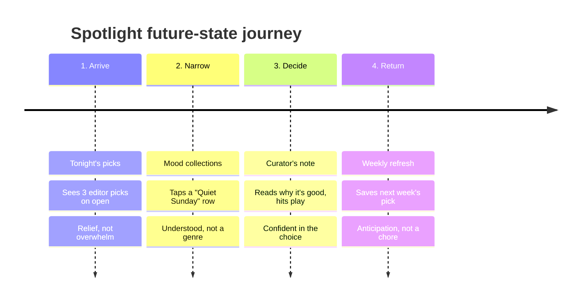

# Spotlight: Future-State Journey

**Persona:** The Overwhelmed Regular, a long-time, heavily engaged subscriber who opens the app most evenings out of habit.
**Goal:** Find something good to watch tonight quickly, without the decision feeling like work.
**Strategy:** Restore brand authority and win back users by prioritizing human-led curation over mass-market scale.

## Timeline

| Stage | Does | Feels | Fixes |
| --- | --- | --- | --- |
| 1. Arrive: Tonight's picks | Sees 3 editor picks on open | Relief, not overwhelm | 20-min scroll (UXR-01, UXR-12) |
| 2. Narrow: Mood collections | Taps a "Quiet Sunday" row | Understood, not a genre | No mood browsing (UXR-07, UXR-09) |
| 3. Decide: Curator's note | Reads why it's good; hits play | Confident in the choice | Low trust in recs (UXR-10, UXR-12) |
| 4. Return: Weekly refresh | Saves next week's pick | Anticipation, not a chore | Re-watch loop (UXR-03) |

## The 4 stages

1. **Tonight's Spotlight (Arrive)**
   - *User action:* Opens the app to three editor-picked titles → decides without scrolling.
   - *Internal state:* Sees a short shortlist chosen by people → feels relief instead of anxiety.
   - *Pain point addressed:* Replaces the twenty-minute scroll → no more sessions closed with nothing watched (UXR-01, UXR-12).

2. **Mood Collections (Narrow)**
   - *User action:* Taps an editorial collection such as "Quiet Sunday" → narrows by intent, not title.
   - *Internal state:* Browses in their own words → feels understood, not sorted into a genre.
   - *Pain point addressed:* Adds the mood browsing that's missing today → no longer limited to exact-title search (UXR-07, UXR-09).

3. **Curator's Note (Decide)**
   - *User action:* Reads a two-line note on why it's worth watching → presses play with confidence.
   - *Internal state:* Trusts a named human voice → commits without second-guessing.
   - *Pain point addressed:* Replaces opaque algorithm picks → answers "just tell me what's good tonight" (UXR-10, UXR-12).

4. **Weekly Refresh (Return)**
   - *User action:* Saves next week's pick to My List → comes back with a plan.
   - *Internal state:* Looks forward to new picks → discovery feels like a treat, not a chore.
   - *Pain point addressed:* Breaks the four-show re-watch loop → more of the existing catalogue gets watched (UXR-03).

## Competitive advantages over the manual workaround

1. **Small choice without leaving the app** → the evening stays on StreamLine instead of going to the DVD shelf.
2. **New titles without effort** → users see titles the re-watch loop never reaches.
3. **Human judgement built in** → delivers the hand-picked curation that drew Tom to a competitor.

## Risks to settle

- **Stage 4 relies on My List, which is broken today.** It doesn't sync between devices (BUG-1058, Critical). Until that's fixed, a pick saved on the phone is lost on the TV, so the journey fails at the point that's meant to bring users back.
- **The premium tier may work against the churn goal.** This persona already pays and is the most exposed to choice overload. If Spotlight is only in a new premium tier, their current plan keeps the overload experience, and the fix for churn becomes an upsell. Decide which stages are in the base plan.
